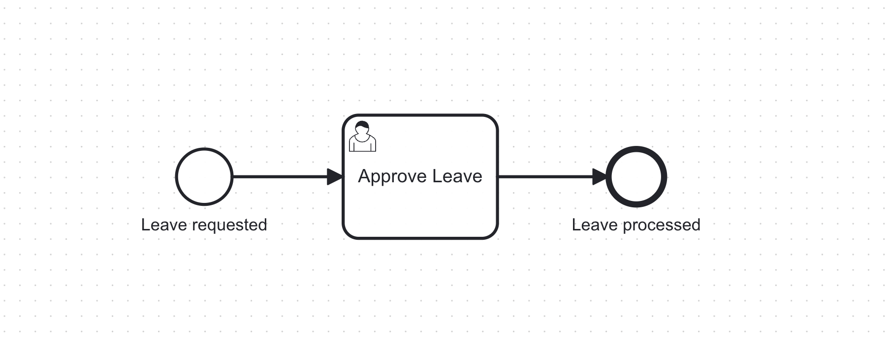
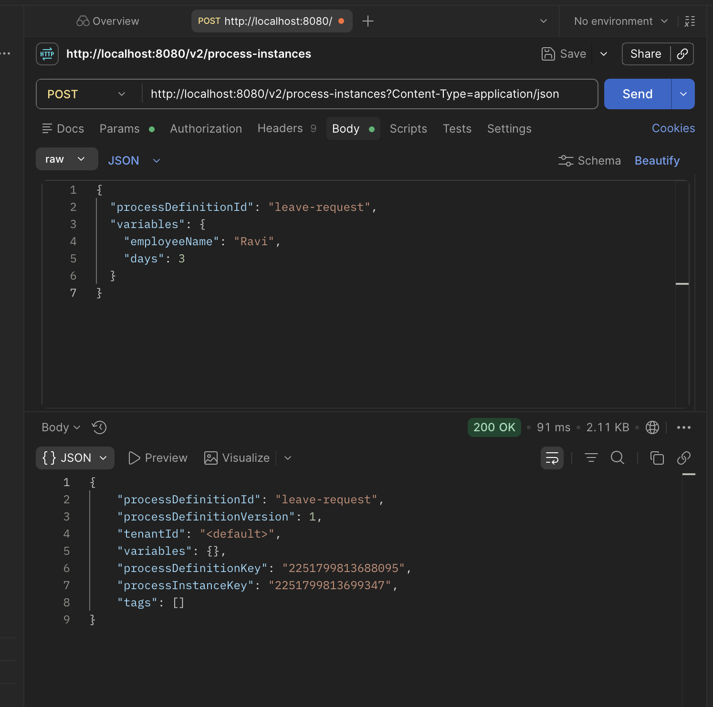
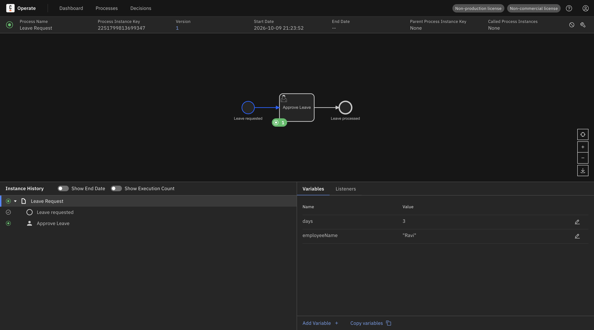

# Start a Camunda 8 Process Using an API Call

**Course:** 21CSE735P – Workflow Automation Engineering
**Institution:** SRM Institute of Science and Technology, Department of Computing Technologies
**Class:** III Year / V Semester
**Tools:** Camunda Modeler, Camunda 8 (C8 Run), Postman, Operate
**Mode:** Individual

## Task

Create a simple **Leave Request** process in Camunda 8, then start it using a REST API call from Postman.

## 1. BPMN Diagram

The process is modeled in Camunda Modeler as Start Event → User Task "Approve Leave" → End Event, with the Process ID set to `leave-request`. It was deployed to the local Camunda 8 (C8 Run) cluster from the Modeler.



## 2. Postman Request and Response

An instance was started with a `POST` request to `http://localhost:8080/v2/process-instances` with this JSON body:

```json
{
  "processDefinitionId": "leave-request",
  "variables": {
    "employeeName": "Ravi",
    "days": 3
  }
}
```

The server returned `200 OK`. The `processInstanceKey` of the new instance is **2251799813699347**.



## 3. Operate: Running Instance

In Operate, the instance `2251799813699347` is active and the token is waiting at the "Approve Leave" user task. Both variables are visible: `days = 3` and `employeeName = "Ravi"`.



## Viva Questions

**1. What is the difference between `processDefinitionId` and `processInstanceKey`?**
The `processDefinitionId` is the BPMN process's identifier (`leave-request`), set in the Modeler and shared by every instance of that process. The `processInstanceKey` is a unique, system-generated number that identifies one specific running instance. The ID is the blueprint, and the key identifies one run of it.

**2. What response do you get if the Process ID is spelled wrong?**
The request fails with `404 Not Found` and an error saying no process definition was found for that process ID. No instance is created.

**3. Start the process 3 times. How many instances appear in Operate?**
Three separate instances appear, all active and waiting at "Approve Leave", each with its own `processInstanceKey`.
